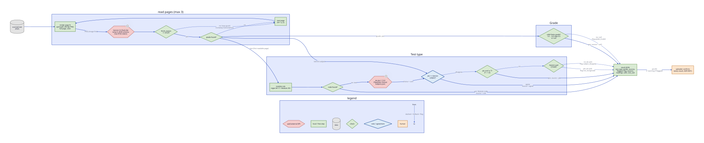

# Final benchmark: OCR_recognition vs Notar

Written 2026-10-13 in the notar repo and copied here: paths such as `src/notar/*` and `docs/benchmark-results.md` refer to that repo, not this one. Compares every setup measured in `../OCR_recognition` (the benchmark repo) with the `notar` pipeline ("this repo" below = notar), names the winner, and documents its pipeline and tech stack.

## Verdict

**Use notar v2.** It gets both fields right on **89.6%** of the 67 test PDFs, against **82.1%** for the best `OCR_recognition` setup, for $0.0002 more per PDF.

|                                    | **notar v2** (this repo)                                       | best of OCR_recognition (`configs/best.yaml`, `gemini_jev`) |
| ---------------------------------- | -------------------------------------------------------------- | ----------------------------------------------------------- |
| **subject + grade both correct**   | **89.6%** (60 / 67)                                            | 82.1% (55 / 67)                                             |
| subject correct                    | **97.0%** (65 / 67)                                            | 94.0% (63 / 67)                                             |
| grade correct                      | **91.0%** (61 / 67)                                            | 86.6% (58 / 67)                                             |
| cost per PDF                       | $0.0014                                                        | $0.0012                                                     |
| cost per 1,000 uploads             | $1.40                                                          | $1.20                                                       |
| says when it is unsure (flags)     | yes, 1 of 7 misses flagged                                     | no                                                          |
| silent errors (wrong, not flagged) | 6                                                              | 12 (no flags at all)                                        |
| purpose                            | production pipeline, one `process()` for service and benchmark | benchmark harness (ablations, grids, prompt variants)       |

Both are scored with the same rules (`src/notar/bench.py`): `CG` = `ECG`, `OTHER` = null, a null in the answer key expects null.

## Every setup measured, ranked

Same 67 PDFs, same scoring rules. ×3 = mean of 3 runs.

| #   | Setup                                                                                                                | Repo  | Runs | Subject   | Grade     | **Both**  | Cost / PDF  | Latency / PDF |
| --- | -------------------------------------------------------------------------------------------------------------------- | ----- | ---- | --------- | --------- | --------- | ----------- | ------------- |
| 1   | **notar v2**: full page, Gemini reads text + subject + grade, Jev with tuned descriptions, page fallback, loop guard | Notar | 1    | **97.0%** | **91.0%** | **89.6%** | $0.0014     | not logged    |
| 2   | `best` gemini_jev: full page, Jev with tuned descriptions, page fallback                                             | OCR   | 1    | 94.0%     | 86.6%     | 82.1%     | $0.0012     | 3.1 s         |
| 3   | notar v1: like v2, but placeholder descriptions and Gemini's OTHER overrides Jev                                     | Notar | 1    | 82.1%     | 89.6%     | 71.6%     | $0.0012     | not logged    |
| 4   | `direct_subject`: top half, Gemini picks the subject, no Jev                                                         | OCR   | ×3   | 78.6%     | 85.5%     | 70.1%     | **$0.0004** | 1.35 s        |
| 5   | `baseline_rerun` gemini_jev: top half, plain subject list                                                            | OCR   | ×3   | 78.6%     | 88.5%     | 68.2%     | $0.0008     | 1.95 s        |
| 6   | `best_low_thinking`: direct_subject + thinking level low                                                             | OCR   | ×3   | 81.6%     | 82.5%     | 68.2%     | $0.0004     | 1.24 s        |
| 7   | `refined_fr`: rewritten prompt in French                                                                             | OCR   | ×3   | 78.1%     | 87.6%     | 67.6%     | $0.0008     | 1.93 s        |
| 8   | initial gemini_jev: top half                                                                                         | OCR   | 1    | 80.6%     | 85.1%     | 67.2%     | $0.0008     | 1.93 s        |
| 9   | `refined`: rewritten prompt + 2 extra grade rules                                                                    | OCR   | ×3   | 77.6%     | 85.1%     | 65.7%     | $0.0008     | 1.99 s        |
| 10  | `header_only`: Gemini transcribes only the header                                                                    | OCR   | ×3   | 70.6%     | 86.6%     | 63.2%     | $0.0006     | 1.63 s        |
| 11  | initial Gemini alone: top half                                                                                       | OCR   | 1    | 74.6%     | 86.6%     | 61.2%     | $0.0004     | 1.86 s        |
| 12  | local Chandra OCR 2 (8-bit, MLX, on the MacBook)                                                                     | OCR   | 1    | 26.9%     | 59.7%     | 14.9%     | $0          | 19.3 s        |

Sources: `docs/benchmark-results.md` (rows 1, 3), `../OCR_recognition/results/` (`best/`, `prompt_variants/`, `scores.csv`).

### What decided it

1. **Tuned subject descriptions are the biggest win.** +12 to +15 points of subject accuracy for free (rows 1–2 vs 3, 5). They live in `src/notar/subjects.json`, copied from `../OCR_recognition/jev/subjects.json` (including the TIB fix: "Travail interdisciplinaire dans les branches").
2. **Jev is worth its call.** In the v2 run Jev alone gets 65/67 subjects right, Gemini alone 57/67. Jev costs $0.042 per 1M input tokens.
3. **Full page beats top half.** Some grades sit below the middle of the page.
4. **Page fallback + loop guard fix grades.** 7 grades recovered in notar vs the previous best (grade on page 2–3, or runaway transcription on page 1).
5. **Flags make the misses visible.** notar returns `flagged` + `flag_reasons`, so the uploader looks closer exactly where it matters. OCR_recognition has no flags.

### What did not work (do not implement)

| Setup                                       | Why not                                                                                           |
| ------------------------------------------- | ------------------------------------------------------------------------------------------------- |
| Local Chandra OCR 2 (row 12)                | 15% both correct, 14× slower. Ignores the JSON schema, names the test instead of the subject      |
| Gemini-only subject, no Jev (rows 4, 6, 11) | Cheapest, but 8 fewer correct subjects                                                            |
| Prompt rewording, French prompt (rows 7, 9) | No gain; the 2 extra grade rules caused regressions (`5//` read as 5.5, points read as the grade) |
| Header-only transcription (row 10)          | Jev gets too little text, subject drops to 70%                                                    |
| Thinking level low (row 6)                  | Subject up, grade down; same "both" score                                                         |

### Noise

Two runs of the same setup disagree on 1–4 files. A gain under about 4 files needs 3 runs and a paired sign test to trust. notar v2 has been run once; its grade noise is not yet measured (see Next steps).

## The final pipeline (notar v2)



Source: [`diagrams/final-pipeline.d2`](diagrams/final-pipeline.d2). Re-render with `d2 docs/ocr_specs/diagrams/final-pipeline.d2 docs/ocr_specs/svg/final-pipeline.svg`.

```d2
direction: right

pdf: "scanned test\n(PDF)" {shape: cylinder}

read: "read pages (max 3)" {
  render: "render page N\npymupdf, 200 dpi PNG\nfull page, color"
  gemini: "Gemini 3.5 flash-lite\ntemp 0, JSON schema\nmax 8192 tokens" {shape: hexagon}
  cap: "finish_reason\n== STOP?" {shape: diamond}
  has_grade: "grade found?" {shape: diamond}
  next: "next page\n(N+1 ≤ 3)"

  render -> gemini: "PNG (image first)"
  gemini -> cap
  cap -> next: "no: loop guard\n(runaway transcription)" {style.stroke-dash: 3}
  cap -> has_grade: "yes"
  has_grade -> next: "no" {style.stroke-dash: 3}
  next -> render
}

type: "Test type" {
  rule: "module rule\nregex M117 / Module 293"
  rule_hit: "code found?" {shape: diamond}
  jev: "Jev jev-1.13.0\n(TypeSafe Choice)\nsubjects.json" {shape: hexagon}
  vote: "Jev == Gemini\nsubject?" {shape: diamond}
  conf: "Jev conf ≥ T?\n(T = 1.0)" {shape: diamond}
  other: "Gemini said\nOTHER?" {shape: diamond}

  rule -> rule_hit
  rule_hit -> jev: "no: text"
  jev -> vote: "choice + conf"
  vote -> conf: "disagree" {style.stroke-dash: 3}
  conf -> other: "no" {style.stroke-dash: 3}
}

grade: "Grade" {
  valid: "valid Swiss grade?\n1.0 … 6.0 step 0.5\nor null" {shape: diamond}
}

out: "result JSON\ntest_type, grade, sources,\nflagged, flag_reasons,\nreadings, calls, cost_usd"
confirm: "uploader confirms\n(every result, ADR 0001)"

pdf -> read.render
read.has_grade -> type.rule: "text (first readable page)"
read.has_grade -> type.vote: "Gemini subject"
read.has_grade -> grade.valid: "grade: yes"

type.rule_hit -> out: "yes: Module code\nsource = rule"
type.vote -> out: "agree\nsource = agree"
type.conf -> out: "yes: source = jev"
type.other -> out: "yes: Jev pick\nflag not_recognized" {style.stroke-dash: 3}
type.other -> out: "no: Jev pick\nflag subject_disagree" {style.stroke-dash: 3}

grade.valid -> out: "yes: source = call1"
grade.valid -> out: "no: null\nflag grade_invalid" {style.stroke-dash: 3}

out -> confirm: "pre-fill\n(+ warning if flagged)"
```

The block above is the diagram without colors, so it renders anywhere. The `.d2` file adds the color classes (red hexagon = paid API, green = local step, orange = human).

### Stages in detail

Code: `src/notar/pipeline.py` (`process()`), `src/notar/providers.py`, `src/notar/config.py`.

| #   | Stage              | Input                             | Output                                                                                                                       | Code                                     |
| --- | ------------------ | --------------------------------- | ---------------------------------------------------------------------------------------------------------------------------- | ---------------------------------------- |
| 1   | Render             | PDF bytes, page N                 | PNG, 200 dpi, full page, color                                                                                               | `render()` (pymupdf `get_pixmap`)        |
| 2   | Gemini read        | PNG (sent before the prompt)      | `{text, subject, grade, grade_box}` + cost                                                                                   | `GeminiProvider.read()`                  |
| 3   | Loop guard         | `finish_reason`                   | `finish_reason != STOP` → reading is `truncated`, page skipped                                                               | `GeminiProvider.read()`, `process()`     |
| 4   | Page fallback      | grade of page N                   | grade null → render page N+1, up to 3 pages. Text comes from the first readable page, grade from the first page that has one | `process()` loop, `Config.max_pages = 3` |
| 5   | Module rule        | transcription                     | Module code (`M117`, `Modul 293`, `Module 293`) or none. A hit skips Jev                                                     | `rule_module()`, `MODULE_RE`             |
| 6   | Jev                | transcription                     | subject choice + confidence, picked from `subjects.json` (tuned descriptions, flattened to paths)                            | `JevProvider.choose()`                   |
| 7   | Test type decision | rule, Gemini subject, Jev reading | `test_type`, `test_type_source`, flags                                                                                       | `decide_test_type()`                     |
| 8   | Grade decision     | raw grade                         | valid Swiss grade or null, flags                                                                                             | `decide_grade()`, `normalize_grade()`    |
| 9   | Result             | everything above                  | result JSON (contract below)                                                                                                 | `process()`                              |
| 10  | Confirmation       | result JSON                       | stored result; the uploader confirms every result                                                                            | Laravel app (separate spec, ADR 0001)    |

### Gemini call (stage 2)

- Model `gemini-3.5-flash-lite`, pinned. Temperature 0. `max_output_tokens = 8192` (full-page transcription is long).
- `response_mime_type = application/json` + JSON schema: `subject` is an enum of the Test types + `OTHER`; `grade` is number or null; `grade_box` is `[ymin, xmin, ymax, xmax]` normalized to 0–1000, or null.
- Prompt asks for a verbatim transcription, the subject being taught (not the language of the test), the final grade (not points like `18/24`), and the grade box.

### Test type rules (stage 7), in order

| #   | Condition                                                                         | Pre-fill                    | `test_type_source` | Flag               |
| --- | --------------------------------------------------------------------------------- | --------------------------- | ------------------ | ------------------ |
| 1   | Module code printed, Gemini says a Module or OTHER                                | the code                    | `rule`             | —                  |
| 2   | Module code printed, Gemini says a Subject                                        | the code                    | `rule`             | `subject_disagree` |
| 3   | No code, but Jev or Gemini reads a Module                                         | Jev's Module, else Gemini's | `none`             | `module_rule_miss` |
| 4   | Jev == Gemini                                                                     | that subject                | `agree`            | —                  |
| 5   | Disagree, Jev confidence ≥ T (T = 1.0, so never yet)                              | Jev                         | `jev`              | —                  |
| 6   | Gemini says OTHER                                                                 | Jev's pick (or null)        | `none`             | `not_recognized`   |
| 7   | Embeddings vote (experiment, off by default): margin ≥ M and top matches one side | that side                   | `embed`            | —                  |
| 8   | Otherwise                                                                         | Jev's pick                  | `none`             | `subject_disagree` |

T stays at 1.0 (every disagreement is flagged) until ≥ 30 disagreements are logged.

### Grade rule (stage 8)

- Valid = {1.0, 1.5, … 6.0} or null (ungraded test). `"5,5"` → 5.5.
- Valid → pre-fill, `grade_source = "call1"`.
- Anything else (points, 5.75, 18, text) → null, flag `grade_invalid`.

### Output contract (Python → Laravel)

```json
{
    "pdf_sha256": "…",
    "test_type": "Anglais",
    "test_type_source": "rule | agree | jev | embed | none",
    "grade": 5.5,
    "grade_source": "call1 | none",
    "flagged": false,
    "flag_reasons": [],
    "readings": {
        "rule": null,
        "jev": { "choice": "Anglais", "confidence": 0.93 },
        "gemini_subject": "Anglais",
        "grade_full_page": 5.5,
        "grade_crop": null,
        "grade_tiebreak": null,
        "grade_box": [120, 610, 210, 820],
        "embed": null
    },
    "fallback": null,
    "calls": { "gemini": 1, "gemini_strong": 0, "jev": 1 },
    "cost_usd": 0.0012,
    "models": {
        "gemini": "gemini-3.5-flash-lite",
        "gemini_strong": null,
        "jev": "jev-1.13.0"
    }
}
```

`fallback` is `{"grade_page": 2}` or `3` when the grade came from a later page. `grade_crop` and `grade_tiebreak` stay null until phase 2.

### Cost per PDF

| Case                                         | Calls              | Cost            | How often (67 PDFs) |
| -------------------------------------------- | ------------------ | --------------- | ------------------- |
| Grade on page 1                              | 1 Gemini + 1 Jev   | ~$0.0012        | 59                  |
| Grade on page 2 or 3                         | 2–3 Gemini + 1 Jev | ~$0.0025–0.0035 | 8                   |
| Worst seen: transcription hits the token cap | —                  | $0.0126         | 1                   |
| **Average**                                  |                    | **$0.0014**     |                     |

Prices (`src/notar/config.py`): Gemini flash-lite $0.25 / 1M input, $1.50 / 1M output; Jev $0.042 / 1M input. Budget in the spec: ≤ $0.003 per test.

## Tech stack

| Layer                        | Choice                                                           | Why                                                                                                  |
| ---------------------------- | ---------------------------------------------------------------- | ---------------------------------------------------------------------------------------------------- |
| Runtime                      | Python 3.14, `uv`                                                | All deps run on 3.14. OCR_recognition pins 3.12 (needed by `mlx-vlm`, which notar dropped)           |
| PDF render                   | `pymupdf`                                                        | Renders any page to PNG at a set dpi; no poppler needed                                              |
| Vision + transcription       | `google-genai` → `gemini-3.5-flash-lite` (`GEMINI_API_KEY`)      | Best accuracy per dollar in the benchmark; JSON schema output; `finish_reason` drives the loop guard |
| Subject choice               | `typesafe-sdk` → Jev `jev-1.13.0`, `Choice` (`TYPESAFE_API_KEY`) | 65/67 subjects alone; returns a confidence for threshold T                                           |
| Module codes                 | stdlib `re`                                                      | Modules are decided by their printed code only                                                       |
| Subject list                 | `src/notar/subjects.json`                                        | Tuned descriptions, the biggest single accuracy win                                                  |
| Embeddings vote (experiment) | `chromadb` (local, `chroma/`) + default `all-MiniLM-L6-v2`       | Votes only on low-confidence disagreements; off unless `--embed`                                     |
| Config                       | `dataclass` in `config.py`                                       | Pinned models, dpi, pages, token cap, T, M, prices                                                   |
| Secrets                      | `python-dotenv`                                                  | `.env` is git-ignored                                                                                |
| Tests                        | `pytest` with fake providers                                     | No live API calls                                                                                    |
| Benchmark                    | `notar bench` / `notar report` (`src/notar/bench.py`)            | Same `process()` as production, cached per PDF in `results/bench.jsonl`                              |
| Next, not built              | `fastapi` + `uvicorn`, Docker, SHA-256 cache                     | One endpoint: PDF in, result JSON out, called from a Laravel queue job                               |

Dropped from OCR_recognition: `mlx-vlm` + Chandra (local model, row 12), `openai` (client for the local server), `opencv`, `jiwer`, `pandas`, `plotly`, `numpy` (ablation and report tooling, not needed in production).

## The 7 remaining misses

| File                        | Expected      | Got        | Why                                                          | Flagged |
| --------------------------- | ------------- | ---------- | ------------------------------------------------------------ | ------- |
| `1_1_Anglais_5_student_B`   | Anglais 5.0   | TIB 5.0    | Page 1 is a French grading grid; Gemini and Jev both say TIB | no      |
| `2_3_Eco&Droit_5_student_A` | Eco&Droit 5.0 | none, none | Runaway transcription on every page                          | yes     |
| `1_2_Histoire_3_student_A`  | 3.0           | none       | Grade not found on 2 pages                                   | no      |
| `2_3_Histoire_5_student_A`  | 5.0           | none       | Grade not found on 3 pages                                   | no      |
| `2_4_Allemand_4_student_A`  | 4.0           | none       | Grade not found                                              | no      |
| `2_1_Allemand_2_student_A`  | 2.0           | 4.0        | Grade misread                                                | no      |
| `2_3_Maths_5_student_C`     | 5.0           | 4.0        | Grade misread                                                | no      |

6 of 7 misses are grades, so the next work is on the grade.

## Next steps, ranked

| Rank | Change                                                                                 | Targets                                     | Effort                      | Extra cost / PDF              |
| ---- | -------------------------------------------------------------------------------------- | ------------------------------------------- | --------------------------- | ----------------------------- |
| 0    | Run notar v2 two more times to measure grade noise                                     | needed before ranks 3–4                     | 10 min                      | ~$0.20 total                  |
| 1    | Loop guard retry: re-read a capped page as the top half                                | `2_3_Eco&Droit_5`                           | ~10 lines in `process()`    | ~$0.001, only on those PDFs   |
| 2    | Add the 40 module codes from the Jev tree to `subjects.json`                           | Module tests in production (none in the 67) | data copy                   | $0                            |
| 3    | Grade re-read on a crop around `grade_box` when the grade is missing (phase 2, call 2) | 3 grade-not-found misses                    | one more Gemini call + crop | ≲ $0.0002, only on those PDFs |
| 4    | Grade tie-break: flag when crop and full-page grades differ                            | 2 silent misreads become flagged            | builds on 3                 | ≲ $0.0002                     |

_(Superseded by `docs/adr/ADR.md` 2026-10-13: the gate for the Laravel port is `ocr:bench` ≥ 56/67.)_ Original ship gate (from `docs/ocr_specs/pipeline-spec.md`), on the ~100-test holdout: unflagged pre-fill accuracy ≥ 98%, flagged share ≤ 15%, cost ≤ $0.003 per test.
